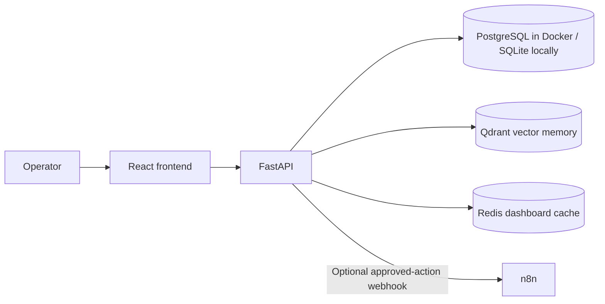
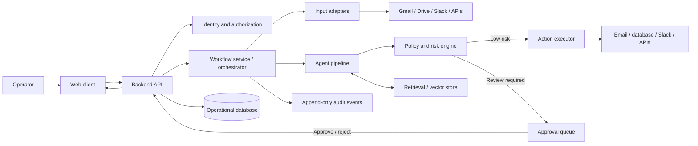

# Pseudo Automation

> **AI workflow operations, with people in control.**

Pseudo Automation is a dashboard concept for observing AI-assisted workflows, configuring connected services, and reviewing consequential actions before execution. Its central promise is simple: make automation understandable—what happened, what is happening, what needs a decision, and what comes next.

> [!IMPORTANT]
> This repository includes the React frontend and a **development FastAPI backend** based on the architecture PDF. The API persists approval tasks, activity, integration ingestion flags, and memory records. Real provider connectors, user authentication, and autonomous AI agents are not configured by default.

## Contents

- [Product at a glance](#product-at-a-glance)
- [Screens and workflows](#screens-and-workflows)
- [Architecture](#architecture)
- [Frontend structure](#frontend-structure)
- [Technology](#technology)
- [Run locally](#run-locally)
- [Build and preview](#build-and-preview)
- [Deploy to Vercel](#deploy-to-vercel)
- [Backend configuration](#backend-configuration)
- [Safety and security](#safety-and-security)
- [Roadmap](#roadmap)

## Product at a glance

The application is organized around these operational areas:

| Area | Purpose |
| --- | --- |
| **Dashboard** | Summarize workflow state, show recent activity, and surface actions needing attention. |
| **Integration Hub** | Show configured input sources and output destinations. |
| **AI Agent** | Provide a natural-language workspace and a preview of proposed workflow configuration. |
| **Approval Gateway** | Review proposed high-impact actions and approve or reject them. |
| **Workflows** | Inspect the configured six-stage agent pipeline. |
| **Memory** | Search stored workflow context and guardrails. |
| **Settings** | Organize profile, account, security, and database administration screens. |

The API seeds example dashboard data on first startup. Integration cards describe connector state; toggling ingestion persists a setting but does not connect to the external provider.

## Screens and workflows

### Dashboard

The dashboard is designed to orient an operator quickly:

1. **Needs attention** — actions awaiting human review.
2. **In motion** — work currently being processed.
3. **Completed** — successfully finished work.
4. **Timeline** — a readable sequence of completed, pending, and review events.
5. **Next action** — a direct path to the approval queue when a decision is needed.

### Integration Hub

Integration configuration should distinguish **input sources** (where workflow data originates) from **output destinations** (where results are delivered). A service may support both roles. A production implementation should show connection state, permissions, last successful sync, and actionable failure details.

### AI Agent

The AI Agent screen presents text, voice, and manual configuration modes, suggested commands, and a configuration preview. In a production system, natural-language requests should produce a structured proposal; they must not silently change an active workflow.

### Approval Gateway

The approval experience explains the proposed action, target, risk, rationale, and policy checks. Decisions are persisted and audited by the backend. External execution occurs only through a configured n8n webhook.

### Settings

Settings groups the profile, account, security, and database management experience. The current controls are presentation-only and do not update a user account or database.

## Architecture

### Current repository



The backend follows the PDF's Python/FastAPI, PostgreSQL, Qdrant, Redis, and n8n stack. Local development defaults to SQLite so the API can run without Docker; `docker compose up --build` starts a local multi-service stack. OpenAI embeddings and n8n action dispatch are opt-in environment settings.

### Recommended production architecture

The following additional services remain future work:



### Suggested workflow lifecycle

```text
Receive event
  -> validate and normalize input
  -> classify intent and extract data
  -> retrieve relevant context
  -> evaluate policy, permissions, and risk
  -> execute an allowed low-risk action OR create an approval request
  -> execute only after authorized approval
  -> verify the result and record an audit event
```

Recommended service boundaries:

| Service | Responsibility |
| --- | --- |
| **API / BFF** | Authenticated UI endpoints, input validation, authorization, and stable client-facing contracts. |
| **Workflow orchestrator** | Durable workflow execution, retries, timeouts, and event coordination. An orchestrator such as n8n is one option. |
| **Agent service** | Model calls, structured extraction, planning, and proposal generation. |
| **Policy service** | Deterministic validation of permissions, risk thresholds, and approval requirements. |
| **Integration adapters** | Isolate provider-specific APIs, credentials, rate limits, and webhook verification. |
| **Approval service** | Persist approval requests, enforce reviewer permissions, and prevent duplicate decisions. |
| **Data and audit services** | Store workflow state, configuration, approval decisions, and tamper-evident audit history. |
| **Memory / retrieval service** | Retrieve relevant, authorized context; keep it separate from the authoritative operational record. |

### Suggested API boundary

The current API exposes:

| Method | Example route | Purpose |
| --- | --- | --- |
| `GET` | `/api/dashboard`, `/api/health` | Dashboard counts and dependency health. |
| `GET` | `/api/approvals` | List persisted approval requests. |
| `POST` | `/api/approvals/{id}/decision` | Record a single approve/reject decision and audit activity. |
| `GET` | `/api/activities` | Read recent workflow and decision events. |
| `POST` | `/api/workflows/simulate` | Persist a simulated six-step workflow without external side effects. |
| `GET`, `PATCH` | `/api/integrations` | Read connector metadata and update ingestion flags. |
| `GET`, `POST` | `/api/memory` | Search lexical memory or Qdrant vectors and create memory records. |

Interactive API docs are available at `/docs` when the API is running. API errors use an HTTP status and a `detail` message.

## Frontend structure

```text
src/
├── components/
│   ├── ActivityFeed.tsx       # Workflow activity and step filtering
│   ├── AIAgentPanel.tsx       # Agent command and configuration preview UI
│   ├── ApprovalGate.tsx       # Approval queue and decision UI
│   ├── Header.tsx             # Page heading and global actions
│   ├── IntegrationsHub.tsx    # Integration cards and ingestion controls
│   ├── MemoryBase.tsx         # Memory record presentation
│   ├── MetricCards.tsx        # Dashboard summary cards
│   ├── SettingsPanel.tsx      # Profile, account, security, database sections
│   ├── Sidebar.tsx             # Primary application navigation
│   └── WorkflowVisualizer.tsx # Workflow node visualization
├── App.tsx                    # App state, navigation, and page composition
├── api.ts                     # Typed client for the FastAPI backend
├── index.css                  # Tailwind import and global styles
├── main.tsx                   # React application entry point
└── types.ts                   # Shared frontend domain types
```

## Technology

- **React 19** and **TypeScript**
- **Vite 8** for development and production builds
- **Tailwind CSS 4** for styling
- **Lucide React** for icons
- **React Router** is installed; the current navigation is controlled by application state
- **FastAPI**, **SQLAlchemy**, **PostgreSQL**, **Qdrant**, and **Redis** for the backend services

## Run locally

### Requirements

- Node.js compatible with Vite 8 (Node.js `20.19+` or `22.12+`)
- npm
- Python 3.12+ (Python 3.14 is also supported by the code)

### Start the backend

```bash
python -m pip install -r backend/requirements.txt
python -m uvicorn backend.app.main:app --reload
```

The API is available at `http://localhost:8000`; its interactive docs are at `http://localhost:8000/docs`. Without `DATABASE_URL`, local state is stored in the ignored `backend/data/` directory using SQLite.

To start PostgreSQL, Qdrant, Redis, and the API together instead:

```bash
docker compose up --build
```

### Start the frontend

In a second terminal:

```bash
npm install
npm run dev
```

Vite prints the local URL in the terminal (normally `http://localhost:5173/`).
The Vite development proxy forwards `/api` requests to the local FastAPI server. Set `VITE_API_BASE_URL` only when the API is hosted elsewhere; it must contain a public API URL and must not contain secrets.

To use a specific port and expose the development server on the local network:

```bash
npm run dev -- --host 0.0.0.0 --port 4173
```

PowerShell users can run the same npm commands from the repository directory.

Run the backend API tests from the repository root with:

```bash
python -m unittest discover -s backend/tests -v
```

## Build and preview

Run the TypeScript check and create a production build:

```bash
npm run build
```

Serve the generated `dist/` build locally:

```bash
npm run preview
```

## Deploy to Vercel

This repository is configured as a static Vite application. The checked-in [`vercel.json`](./vercel.json) sets the Vite framework, runs the production build, publishes `dist/`, and sends unmatched paths to the app entry point for client-side routing.

### Deploy from the Vercel dashboard

1. Push this repository to GitHub, GitLab, or Bitbucket.
2. In Vercel, choose **Add New → Project** and import the repository.
3. If Vercel asks for a **Root Directory**, select the directory that contains this `package.json` and `vercel.json`. For this repository, that is the project root.
4. Confirm the detected settings:
   - Framework preset: **Vite**
   - Build command: `npm run build`
   - Output directory: `dist`
   - Install command: `npm install` (or leave Vercel's detected npm command)
5. Select **Deploy**. Subsequent pushes to the connected branch create new deployments.

### Deploy with the Vercel CLI

From the directory containing `package.json`:

```bash
npx vercel
```

To create a production deployment:

```bash
npx vercel --prod
```

The CLI may prompt you to sign in and link the local project to a Vercel project.

### Environment variables and backend

The frontend can still build without the backend, but its API-backed views need a running API to load and change persisted data. Deploying the UI to Vercel does not deploy the API, database, authentication, provider integrations, or AI agent runtime.

Deploy the API and its database/vector services separately from the static Vercel frontend, then set `VITE_API_BASE_URL` to the backend's public `/api` URL. Never put API keys, OAuth client secrets, database credentials, or model provider secrets in `VITE_*` variables: Vite embeds them in client-side assets.

## Backend configuration

| Variable | Purpose |
| --- | --- |
| `DATABASE_URL` | SQLAlchemy URL. Defaults to local SQLite; Compose configures PostgreSQL. |
| `QDRANT_URL` | Optional Qdrant URL; vector collection is initialized at startup. |
| `QDRANT_API_KEY` | Optional Qdrant authentication key. |
| `OPENAI_API_KEY` | Optional server-side key for `text-embedding-3-small` memory vectors. |
| `EMBEDDING_MODEL` | OpenAI embedding model name. |
| `REDIS_URL` | Optional Redis URL for cached dashboard summaries and `/api/health`. |
| `N8N_APPROVAL_WEBHOOK_URL` | Optional n8n webhook. Approved tasks dispatch only when configured. |
| `CORS_ORIGINS` | Comma-separated browser origins allowed by the API. |

Without Qdrant and an embedding key, memory search uses a local lexical match. Without an n8n webhook, approvals are recorded as `awaiting_dispatch` and do not trigger external actions.

## Safety and security

For any real deployment:

- Keep provider secrets and model credentials on the server; never place them in frontend source or `VITE_*` variables.
- Treat model output and integration payloads as untrusted input. Validate against strict schemas.
- Enforce authorization and approval policy at the backend boundary for every consequential action.
- Make approval records auditable and bind decisions to the exact action payload, target, and version being approved.
- Use idempotency keys and replay protection for execution and webhook endpoints.
- Apply least-privilege OAuth scopes, secret rotation, rate limits, and tenant isolation.
- Avoid storing unnecessary personal or sensitive data in prompts, logs, or vector memory.
- Do not present sample metrics or simulated statuses as live production telemetry.
- This starter API does not implement login, organization roles, or tenant isolation. Do not expose it publicly until an authentication/authorization layer is added.
- Connector toggles update persisted ingestion flags only; provider OAuth credentials and adapters are not included.
- The Compose PostgreSQL credentials are local-development defaults; replace them and add authentication before any shared or production deployment.

## Roadmap

- [x] Add backend API and typed client contracts
- [x] Persist approval decisions, workflow activity, integration flags, and memory records
- [ ] Replace remaining sample content with live dashboard and settings data
- [ ] Add authentication, organization roles, and access-controlled approvals
- [ ] Connect real integrations through server-side adapters
- [ ] Add workflow configuration persistence and validation
- [ ] Add audit history, observability, and resilient error handling
- [ ] Add automated component and end-to-end tests

## Contributing

Keep changes focused, typed, and consistent with the existing component patterns. Before opening a pull request, run:

```bash
npm run build
```

When tests or lint scripts are added to `package.json`, include their commands and run the relevant checks for each change.
